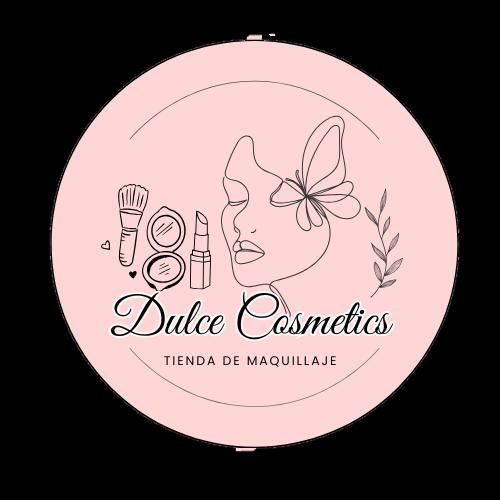

<!-- CONFIG FULL_NAME: Edwin Alejandro Esquivel Bahamón -->
# Dulce Cosmetics — Boutique & Catálogo Oficial de Belleza (Neiva)

  
  <h3>Realza tu resplandor natural con productos de belleza y cuidado personal en Neiva, Huila</h3>
  
<strong>Propietaria & Creadora:</strong> Natalia Narváez &nbsp;|&nbsp; <strong>Desarrollo Web:</strong> Edwin Alejandro Esquivel Bahamón

---

## 🌸 Sobre Dulce Cosmetics

**Dulce Cosmetics** es un emprendimiento comercial independiente y de dedicación personal, creado y liderado por **Natalia Narváez** en la ciudad de **Neiva, Huila**. Nació con la pasión de ofrecer cosméticos, maquillaje y productos de cuidado facial de alta calidad a precios accesibles, seleccionados minuciosamente para adaptarse a las necesidades de las mujeres y al clima cálido de nuestra región.

Cada producto de nuestro catálogo ha sido elegido pensando en duración, confort, acabados impecables y formulaciones amigables con tu piel.

---

## 💄 Lo que Ofrecemos en Nuestra Tienda

Contamos con una amplia variedad de cosméticos y accesorios seleccionados de las mejores marcas del mercado:

- **Pestañinas de Larga Duración (Waterproof):** Pestañina 4D a prueba de agua, Pestañina Volumen Extra y Pestañina Transparente fortalecedora con efecto fijador resistente a la humedad.
- **Labiales, Brillos y Tintas:** Tintas con textura gelatina para labios y mejillas, labiales mate indelebles, labiales mágicos Engol y brillos mágicos con destellos sutiles.
- **Rostro & Acabados Impecables:** Polvo suelto de arroz para control de brillo y grasa, polvos compactos, bases líquidas de alta cobertura, correctores fluidos y rubores dobles.
- **Efecto Glow & Tendencia:** Polvos de hadas con aplicador en esponja para rostro, cuello y cuerpo, e iluminadores sedosos.
- **Cuidado Facial (Skincare):** Mini kits de rutina completa Bioaqua (Ácido Hialurónico, Arroz y Rosas), mascarillas en velo nutritivas y protectores solares ultraligeros.
- **Fijación & Preparación:** Fijadores de maquillaje de extracto de arroz y primer facial en gel suavizante de poros.
- **Herramientas & Accesorios de Belleza:** Esponjas Beauty Blender, rizadores profesionales de pestañas, cepillos definidores, perfiladores faciales y caimanes de cabello.

---

## 📍 Ubicación Física y Canales de Contacto

Puedes visitar el punto de entrega de Natalia o solicitar tu pedido con entrega a domicilio directa:

- 🏬 **Sede Física:** Carrera 7 #38-16, Barrio Las Granjas — Neiva, Huila (Colombia).
- 📱 **Líneas de Pedidos y Asesoría WhatsApp:**
  - **+57 317 778 0413** (Línea Principal de Atención)
  - **+57 320 436 0859** (Línea de Domicilios y Despachos)
- 🛵 **Cobertura de Domicilios en Neiva:**
  - **Barrio Las Granjas:** ¡Domicilio **GRATIS** por compras desde **$15.000 COP**!
  - **Zonas de Cobertura:** Cándido, Centro, Ipanema, Altico, Quirinal, Oriente, Sur y zonas aledañas de Neiva.
  - Envíos a municipios vecinos del Huila bajo previa coordinación.
- 💳 **Medios de Pago:**
  - Efectivo contraentrega en Neiva (pagas al recibir tu pedido).
  - Transferencia directa e inmediata por **Nequi** o **Daviplata**.

---

## ✨ Experiencia de Compra Digital

La plataforma web de Dulce Cosmetics fue concebida para brindarte una compra ágil y amigable tanto desde tu celular como desde tu computador:

1. **Navegación Intuitiva:** Explora productos por categorías o busca directamente por nombre o tonalidad.
2. **Selección de Tonos y Variantes:** Revisa los swatches reales de los tonos disponibles antes de agregarlos al carrito.
3. **Cálculo de Domicilio Automático:** Al ingresar tu barrio en Neiva, el sistema calcula tu costo de envío exacto y te informa si tienes domicilio gratis.
4. **Pedido a un Clic por WhatsApp:** Tu pedido se genera formateado con la lista de productos, total y dirección para que Natalia te atienda y despache de inmediato.

---

## ⚠️ NORMAS, REGLAS CLARAS Y PROTECCIÓN DEL NEGOCIO

> [!IMPORTANT]
> **AVISO LEGAL Y PROTECCIÓN DE DERECHOS DE AUTOR**
>
> 1. **Titularidad Exclusiva:** **Dulce Cosmetics** es un emprendimiento unipersonal de propiedad de **Natalia Narváez**. Todos los derechos sobre la marca, el catálogo comercial, las fotografías, las listas de precios, la selección de inventario y los datos de clientela son de su titularidad exclusiva.
> 2. **Prohibición de Copia y Plagio:** Queda expresamente prohibida la copia parcial o total, duplicación de catálogo, suplantación de identidad del negocio, descarga masiva o extracción automatizada (*scraping*) de fotografías y descripciones para cualquier fin comercial ajeno sin la autorización previa y por escrito de Natalia Narváez.
> 3. **Protección de Datos de Clientes (Ley 1581 de 2012 de Colombia - Habeas Data):** La información suministrada por los compradores (nombres, números telefónicos, direcciones de entrega e historial de pedidos) es estrictamente confidencial. Se encuentra terminantemente prohibido extraer, comercializar, ceder o transferir datos de compradores a terceros.
> 4. **Respeto a las Fórmulas y Proveedores:** Las recetas, referencias comerciales y acuerdos de distribución local pertenecen al ámbito privado de la titular del emprendimiento.

---

## 👥 Créditos del Proyecto

- **Propietaria & Representante Comercial:**  
  **Natalia Narváez** — Creadora de Dulce Cosmetics (Neiva, Huila).

- **Desarrollador de Software:**  
  **Edwin Alejandro Esquivel Bahamón**  
  GitHub: [@edwin-esquivel-ADSO](https://github.com/edwin-esquivel-ADSO)  
  Programa: Tecnólogo en Análisis y Desarrollo de Software (ADSO) — **SENA Ficha 3413974**  
  Instructor Principal: **Jesús Ariel**

---

> [!NOTE]
> Para consultar la especificación técnica, código fuente, esquema de base de datos relacional y arquitectura de software, dirígete al documento técnico en [docs/ARCHITECTURE.md](docs/ARCHITECTURE.md).
